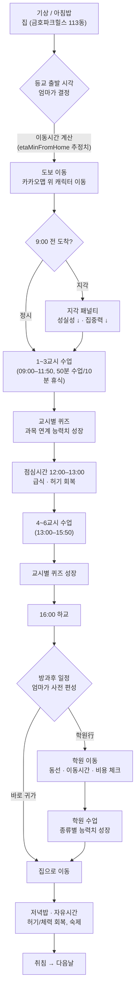

# 이로이의 하루 — 설계 문서 v0.1

프린세스 메이커 2 스타일의 생활 육성 시뮬레이션. 서울 성동구에 사는 초등학교 2학년 "이로이"의 등교·수업·학원·귀가 하루를 실제 동선을 고려해 보낸다.

- 장르: 생활 시뮬레이션 / 자녀 육성
- 플랫폼: 웹 브라우저
- 지도 엔진: **카카오맵 API (확정)** — JS SDK(지도 표시) + 로컬 API(지오코딩). 계정당 첫 앱은 카드 등록 없이 무료 쿼터(SDK 일 30만 건, 지오코딩 일 10만 건) 적용. 길찾기는 제공하지 않아 이동시간은 `etaMinFromHome` 추정치로 대체.

## 01. 캐릭터 & 무대

| 구분 | 이름 | 주소 | 비고 |
|---|---|---|---|
| 주인공 | 이로이 (초2, 8세) | — | 플레이어는 "엄마" 시점으로 하루 일정을 편성 |
| 집 | 금호파크힐스 113동 | 서울 성동구 금호로 140 일대 (금호동1가) | 동 출입구 좌표를 지오코딩 기준점으로 사용 |
| 학교 | 서울금북초등학교 | 서울 성동구 행당로1길 13 | 집에서 도보 약 10분 내외 거리 |
| 학원 권역 A | 동네 학원가 | 금호·행당 일대 (가상 배치, 집 도보 10분) | §05 참고 |
| 학원 권역 B | 압구정 프리미엄 교육 | 강남구 압구정동 (미정) | 이동시간·비용 ↑, 성장 효율 ↑ |

> 실제 위도·경도는 카카오 로컬 API(지오코딩)로 확정한다. 이 문서의 좌표는 모두 placeholder.

## 02. 하루 루프



### 시간표 기준

| 구간 | 시각 | 내용 |
|---|---|---|
| 등교 가능 구간 | 07:30–08:59 | 엄마가 출발 시각 지정 (이동시간 감안해 9시 전 도착) |
| 1~3교시 | 09:00–11:50 | 매 정시부터 50분 수업 + 10분 휴식 |
| 점심시간 | 12:00–13:00 | 급식 — 허기 회복의 기본 축 |
| 4~6교시 | 13:00–15:50 | 동일 패턴 |
| 하교 | 16:00 | 학원 이동 또는 귀가 분기 |

## 03. 능력치 시스템

6개 기본 능력치. 수업 퀴즈와 방과후 학원 활동이 서로 다른 능력치를 성장시키며, 허기·체력 상태에 따라 성장 효율이 달라진다.

| 능력치 | 설명 | 주요 성장 경로 |
|---|---|---|
| 지력 | 국어·수학·탐구 이해력 | 교과 퀴즈, 교과/논술/코딩 학원 |
| 체력 | 기초 건강, 피로 회복력 | 급식·저녁밥, 체육 퀴즈, 운동학원 |
| 근력 | 신체 능력, 운동 수행력 | 축구·농구·야구·태권도 학원 |
| 감성 | 음악·미술·표현력 | 음악/미술 퀴즈, 미술·코딩 학원, 압구정 예술 아카데미 |
| 사회성 | 발표·교우관계·협동 | 국어 퀴즈(발표), 창의적 체험활동, 팀스포츠·논술 학원 |
| 성실성 | 생활습관, 등교/과제 태도 | 정시 등교, 숙제 완료, 태권도 등 규율형 학원 |

교과 → 능력치 매핑은 데이터로 관리한다 → [`data/subjects.json`](../data/subjects.json)

```
성장치 = 기본계수(과목·난이도) × 퀴즈정답여부(0 or 1) × 허기보정 × 체력보정
```

## 04. 허기 · 체력

- **허기도(0–100)**: 시간이 지날수록 자연 감소(교시당 −6 내외). 급식·저녁밥·간식으로 즉시 회복. 30 이하 "배고픔".
- **체력(0–100)**: 수면·식사로 회복, 수업·학원·이동으로 소모.

| 상태 | 조건 | 효과 |
|---|---|---|
| 배고픔 | 허기 ≤ 30 | 퀴즈 정답률 −20%p, 능력치 성장 배율 ×0.5 |
| 공복 위험 | 허기 ≤ 10 | 체력 자연 감소 시작 |
| 충분 | 허기 ≥ 60 | 능력치 성장 배율 ×1.0 (기본값) |
| 저체력 | 체력 ≤ 20 | 운동학원 참여 불가, 이동속도 저하 |

```
허기보정계수 = 허기 < 30 → 0.5  /  30–59 → 0.8  /  60↑ → 1.0
```

### 스트레스 (프린세스 메이커 2 스타일 과로 페널티)

학교·학원·집안일 블록을 소화할 때마다 스트레스가 쌓인다(학교 +10, 학원 +18, 집안일 +6). 하루가 끝나면 수면으로 일부 회복되고(평소 −15, 일정이 하나도 없던 날은 −30), 다음 날로 넘어가며 누적된다. **스트레스가 80을 넘으면 그 자리에서 몸살이 나서 그날 남은 일정이 전부 취소되고 곧장 귀가** — 하루에 학원을 너무 많이 몰아넣는 걸 막는 장치다. 몸살이 나면 스트레스가 40 즉시 완화된다.

### 집안일 돕기 (용돈벌이)

학원이 돈을 쓰는 쪽이라면, 집안일 돕기는 버는 쪽이다. 시간표에 30분 블록으로 배치하며, 완료하면 용돈 800원 + 성실성 +1을 얻는 대신 허기 −8·체력 −8·스트레스 +6이 든다. 이미 집에 있는 상태에서 배치하면 이동 없이 바로 진행된다(학교/학원 다녀온 뒤 배치하면 먼저 귀가 이동부터 해야 함).

### 상점 (용돈 소비)

번 돈을 쓸 곳도 필요해서 상점을 추가했다. 시간표와는 별개로, 계획 단계에서 언제든 `data/items.json`의 아이템을 사면 즉시 효과(능력치 또는 허기 회복)가 적용된다. 하루가 진행 중일 때는 구매 불가.

## 05. 학원 & 동선

방과후 학원은 매번 엄마(플레이어)가 선택한다. 성장 능력치뿐 아니라 **동선(학교→학원→집)**, **이동시간**, **비용**, **체력 소모**를 함께 고려한다.

학원 종류(규칙)와 실제 학원(콘텐츠)을 분리해 관리한다 → [`data/academy_categories.json`](../data/academy_categories.json), [`data/academies.json`](../data/academies.json)

| 카테고리 | 실제 후보 | 권역 | 주요 성장 | 동선 |
|---|---|---|---|---|
| 무도 | 태비KTS태권스쿨 | 동네 (가상, 집 도보 10분) | 근력·성실성 | 도보 10분 |
| 미술 | 하이파이브미술학원 성동캠퍼스 | 동네 (가상, 집 도보 10분) | 감성 | 도보 10분 |
| 논술·독서토론 | 씨엔에이논술 행당점 | 동네 (가상, 집 도보 10분) | 지력·사회성 | 도보 10분 |
| 코딩·STEAM | 창의코딩랩 AI코딩학원 | 동네 (가상, 집 도보 10분) | 지력·감성 | 도보 10분 |
| 구기 운동 | 축구·농구·야구 (미정) | 동네 | 근력·사회성 | 도보 5–15분, 체력 소모 큼 |
| 프리미엄 교육 | 압구정 영어회화·창의수학·예술 (미정) | 강남(압구정) | 지력·감성 (고배율) | 차량/대중교통 20–40분, 고비용 |

### 학원 선택 판정 로직

1. **도착 가능성** — 학교→학원 이동시간 + 학원 운영시간이 16:00 이후 일정과 맞는지
2. **귀가 가능성** — 학원→집 이동시간을 더해 저녁밥 시간을 넘기지 않는지
3. **예산 검증** — 이번 달 남은 교육예산에서 수강료 차감 가능한지
4. **체력 검증** — 현재 체력이 해당 학원의 최소 요구 체력 이상인지

## 06. 예산 시스템

매월 21일 엄마·아빠의 월급이 들어오고 그 달 교육 예산이 재계산된다.

```
이번달_교육예산 = (엄마월급 + 아빠월급) × 교육비_비율 − 고정지출(생활비·관리비 등) + 전월_이월분
```

| 항목 | 시점/주기 | 비고 |
|---|---|---|
| 월급 입금 | 매월 21일 | 예산 재계산 트리거 |
| 동네 학원 수강료 | 월 단위 선결제 | 등록 시 즉시 차감 |
| 압구정 프리미엄 수강료 | 월 단위 선결제, 고액 | 왕복 교통비 별도 차감 |
| 식비·간식 | 매 식사 이벤트 | 급식은 무상, 간식/외식만 차감 |
| 예산 초과 | 즉시 | 등록 불가 — 대체 학원 추천 |

**구현 현황**: 월급·학원비 연동 전체는 아직이지만, 교통비 차감만 먼저 들어갔다 — `character.wallet`(용돈, 초기 5,000원)에서 버스·지하철 요금(각 450원)이 매 탑승마다 즉시 빠진다. 잔액이 부족하면 해당 교통수단 버튼이 비활성화된다.

## 07. 지도 이동 모듈

지도 제공사는 **카카오맵 API**로 확정했다. 계정당 처음 활성화한 앱은 결제수단 등록 없이 무료 쿼터가 제공되고(SDK 일 30만 건, 지오코딩 일 10만 건), 네이버·구글은 키 발급 단계부터 카드 등록이 필요해 제외했다. 게임 로직은 카카오맵 SDK를 직접 호출하지 않고 아래 `MapService` 인터페이스를 통해서만 접근한다.

API 키는 [카카오 디벨로퍼스](https://developers.kakao.com)에서 본인 계정으로 앱을 생성해 JavaScript 키를 발급받아야 한다(이 계정의 첫 앱이어야 무료 쿼터 적용). 카카오는 도보 길찾기 API를 제공하지 않으므로, `getRoute()`는 실제 구현에서도 두 좌표 사이 직선 경로 + `Academy.location.etaMinFromHome` 추정치로 소요시간을 계산한다 — 배경은 실제 카카오맵이라 "실감나는 이동"은 유지된다.

```ts
interface MapService {
  geocode(address: string): Promise<LatLng>

  getRoute(
    from: LatLng,
    to: LatLng,
    mode: "walk" | "transit" | "car"
  ): Promise<{ path: LatLng[], durationSec: number, distanceM: number }>

  spawnCharacter(at: LatLng): CharacterMarker

  moveCharacterAlong(
    marker: CharacterMarker,
    path: LatLng[],
    gameMinutesPerRealSecond: number
  ): Promise<void>

  onArrive(marker: CharacterMarker, cb: () => void): void
}
```

실제 좌표가 들어오기 전까지는 `etaMinFromHome` 값으로 이동 로직을 먼저 검증한다.

```
지각 여부 = (도착시각) > (블록 시작시각)
```

**이동수단 선택**: 모든 이동 구간 시작 시 도보/버스/지하철 중 고른다(학원·활동의 `mode`가 `"transit"`이면 도보는 숨김 — 압구정·불암산·중계동처럼 현실적으로 걸어갈 수 없는 거리). 도보는 방향키/터치로 직접 조작하는 실시간 이동(§ 아래), 버스·지하철 모두 요금은 450원(어린이 교통카드 기준)으로 동일하게 두었다.

**버스·지하철은 실제 정류장·역 기반 3단계**로 처리한다(2026-11 업데이트, `data/stations.json`): "타기" 버튼을 누른다고 바로 목적지로 가는 게 아니라 ①현재 위치에서 가장 가까운 정류장/역까지 도보(방향키 조작), ②그 역에서 목적지와 가장 가까운 정류장/역까지 빠른 이동(요금은 이 시점에 차감), ③도착한 정류장/역에서 실제 목적지까지 다시 도보 — 세 단계를 순서대로 밟는다. 출발역과 도착역이 같으면 ②는 생략된다. 정류장/역이 목적지에서 너무 멀면(버스 2km·지하철 6km 초과) 그 수단 자체가 비활성화된다 — 지금은 금호동 인근 정류장 3곳만 있어서 노원구처럼 먼 목적지는 사실상 지하철만 선택할 수 있다.

지하철역 5곳은 전부 실제 도로명주소로 지오코딩된다. 버스정류장은 카카오 장소검색이 정류장 이름을 못 찾거나(또는 엉뚱한 곳을 매칭해서) 신뢰할 수 없어, 실제 지번주소가 있는 곳만 지오코딩하고 나머지는 집 근처 가상 위치로 분산 배치한다.

**도보 이동 속도**: 캐릭터 이동 60m/s, 게임 시계는 걷는 동안 실시간 1초당 1게임분 진행. 버스/지하철은 거리 220m당 1게임분으로 환산(최소 5분), 화면 연출은 1.8초 고정 애니메이션.

## 08. 데이터 모델

**원칙**: "학원이 무엇을 성장시키는가"(규칙, 거의 안 바뀜)와 "그 학원이 실제로 어디 있고 얼마인가"(콘텐츠, 언제든 추가)를 분리한다. 새 학원·새 과목 추가는 테이블에 행을 추가하는 것으로 끝나고, 게임 로직 코드는 건드리지 않는다. 실제 파일은 [`data/`](../data) 참고.

- `Character` — 캐릭터 상태 (`data/character.json`)
- `AcademyCategory` — 학원 종류별 성장 규칙 (`data/academy_categories.json`)
- `Academy` — 실제 학원 인스턴스 (`data/academies.json`)
- `Subject` — 교과목별 성장 규칙 (`data/subjects.json`)
- `Item` — 상점 아이템과 효과 (`data/items.json`)
- `Activity` — 방과후 활동(집안일·심부름·나들이)과 효과 (`data/activities.json`) — `location`이 `"home"`이면 이동 없이 즉시 진행하고, 그 외(`"place"`)면 `mode`(`"walk"`/`"transit"`)로 도보 가능 여부를 정하며 `address`를 먼저 지오코딩하고 실패하면 `placeQuery`로 장소검색, 그것도 실패하면 `travelMin` 기반 가상 위치를 쓴다
- `Station` — 실제 지하철역·버스정류장 (`data/stations.json`) — 역은 도로명주소로 지오코딩, 정류장은 실제 지번주소가 있는 곳만 지오코딩하고 나머지는 가상 위치
- `DailySchedule` — 하루 일정 (현재는 `scheduleBlocks` 배열로 런타임에만 존재, 파일로는 미분리)
- `FamilyBudget` — 가계 예산 (구현 시 추가, 지금은 `character.wallet` 하나로 단순화)

## 09. 화면 구성

**디자인 방향**: 프린세스 메이커 2의 UI *구조*(항상 보이는 캐릭터 상태 사이드바, 아이콘 기반 커맨드 선택, 서사형 로그창)만 참고하고, 그림체·색감·폰트는 전부 독자적으로 새로 만들었다 — 판타지 소녀 육성 게임이 아니라 "현실 한국 초등학생의 알림장·시간표"를 모티프로 삼았다. 배경은 연한 노트 줄선 패턴, 패널마다 색인 탭처럼 색이 다른 상단 띠(학교=코랄, 학원/지도=하늘색, 집안일=초록, 상점=보라), 제목은 손글씨 느낌의 "Jua"/"Gaegu" 폰트, 본문은 "Gowun Dodum". 그림/음악/텍스트 등 실제 저작물을 가져온 것은 전혀 없다.

- **좌측 캐릭터 사이드바** (PM2의 "항상 보이는 상태창" 구조 차용, sticky): 아바타 이모지 + 이름, 능력치 6종을 아이콘·게이지 바로, 허기·체력·스트레스·용돈을 알약 모양 배지로 표시. 그 아래에 화면 전환용 커맨드 버튼 5개 — 오늘 일정 · 학원정보 · 활동정보 · 지도 · 상점.
- **메인 뷰 전환 구조**: 오른쪽은 단일 패널(`#main-view`)이고, 사이드바 버튼을 누르면 그 안의 `.view` 중 하나만 보이고 나머지는 숨는다(탭 전환과 동일, DOM 재배치 없이 `hidden` 토글로 구현). 기본 화면은 "오늘 일정"이고, **"일과 시작"을 누르면 자동으로 "지도" 화면으로 전환**된다 — 하루가 실행되는 동안에는 지도·이동수단 선택·진행 로그를 한 화면에서 본다.
  - *학원정보*: 학원 이름·운영시간·위치(주소)·성장 효과.
  - *활동정보*: 활동 이름·소요시간·위치·효과(용돈/스탯/허기·체력·스트레스 증감)를 한 줄로. 지금은 집안일 돕기(30분/60분 두 가지)와 나비정원 다녀오기(3시간, 서울숲 나비정원 지오코딩 시도) 세 가지.
  - *지도*: 카카오맵이 숨겨진 상태로 초기화되면 크기가 0으로 깨지는 문제가 있어, 탭을 열 때마다 `map.relayout()`을 호출해 재계산한다.
- **하루 일정 시간표**: 07:00–21:00 세로 시간표에 아이콘 타일(학교·활동·학원)을 드래그해서 배치하는 플래너. 학교(09:00–16:00)는 기본 배치되어 있고 제거·재배치 가능. 겹치는 시간대는 드롭이 거부된다.
- **이동수단 선택 / 하루 로그**: 이동할 때마다 뜨는 선택 패널과, 진행 상황을 적어 내려가는 로그창을 일기장처럼 스타일링(손글씨 폰트, 점선 노트 테두리) — 지도 화면 안에 함께 있다.
- **상점**: 아이템 아이콘 + 구매 버튼, 하루 진행 중에는 비활성화.
- **퀴즈 팝업** (미구현): 교시 시작 시 과목에 맞는 간단 퀴즈 1문항.
- **가계부 화면** (미구현): 21일 월급 입금, 이번 달 교육예산 잔액, 학원별 지출 내역.

## 10. 다음 단계

- [x] 카카오 디벨로퍼스에서 앱 생성 → JavaScript 키 발급, 카카오맵(OPEN_MAP_AND_LOCAL) 제품 활성화
- [x] `MapService`를 카카오맵 JS SDK로 구현 — 집·학교는 실제 지오코딩, 학원은 `etaMinFromHome` 기반 추정 위치
- [x] 집 위치를 카카오 키워드 장소검색으로 113동 건물 단위까지 정밀화
- [x] 하루 일정을 드래그 앤 드롭 시간표로 계획 → "일과 시작" → 이동 구간은 방향키/터치로 직접 조작, 수업·학원 시간은 자동 진행, 지각 판정·급식·학원 성장치·저녁밥까지 한 사이클 완주 (`index.html`/`main.js`)
- [x] 도보 이동/게임시계 속도 2배 상향, 버스·지하철 이동 옵션 추가 — 탑승 시 `character.wallet`에서 요금(450원) 차감. 압구정 프리미엄 학원처럼 `location.mode: "transit"`인 학원은 도보 선택지 자체가 빠짐
- [x] 프린세스 메이커 2의 플레이 방식(장르적 메커니즘, 저작물이 아닌 규칙만 참고) 중 세 가지 도입: 집안일 돕기(용돈벌이), 스트레스 누적 → 과로 시 하루 강제 종료, 상점(용돈 소비 → 즉시 스탯 효과)
- [x] 전체 UI를 PM2 스타일 구조(고정 상태 사이드바·아이콘 커맨드·일기장식 로그)로 재설계, 비주얼은 "한국 초등학생 알림장" 컨셉으로 독자 제작 (Jua/Gaegu/Gowun Dodum 폰트, 노트 줄선 배경, 패널별 색인 탭)
- [x] 사이드바에 학원정보·활동정보·지도·상점 탭 전환 버튼 추가, "일과 시작" 시 지도 화면으로 자동 전환. 집안일을 `data/activities.json` 기반의 "활동" 시스템으로 일반화(집안일 30/60분, 나비정원 나들이 3시간)해서 여러 개 추가할 수 있게 함
- [x] 학원 4곳(태비KTS태권스쿨·아담리즈수학·씨앤에이논술·창의코딩랩·하이파이브미술학원)의 실제 주소 반영, 아담리즈수학 성동직영센터 신규 추가(카테고리 `math` 신설). 압구정만 아직 미정.
- [x] 버스·지하철을 실제 정류장·역(`data/stations.json`) 기반 "걷기→타기→걷기" 3단계로 재구현, 목적지에서 너무 먼 수단은 자동 비활성화
- [x] 활동을 중계동 심부름·외할머니댁 심부름으로 확장, 나비정원을 실제 위치(불암산 나비정원, 노원구)로 교정 — 둘 다 노원구라 지하철 전용으로 설정
- [ ] 엔딩/진로 분기 — 특정 시점의 스탯에 따라 결과가 갈리는 구조 (사용자가 1·2·3 먼저 진행 요청, 아직 미착수)
- [ ] 교시별 퀴즈 (이로이놀이터처럼 과목별 문제를 풀어 정답 수에 따라 해당 능력치가 더 빨리 성장하는 방식) — 사용자가 "아직은 어려울듯"이라 보류, 방과후 학원에서만 능력치가 성장하는 현재 상태 유지
- [ ] 능력치/허기/예산 수치 밸런싱
- [ ] 압구정 프리미엄 아카데미의 실제 학원·주소·운영시간·수강료 확인, 태비KTS·아담리즈수학·씨앤에이논술·창의코딩랩·하이파이브미술학원의 실제 수강료 확인
- [ ] 금호119안전센터 정류장의 정확한 지번주소 확인 (현재 가상 위치)
- [ ] `FamilyBudget`(월급·학원비)을 실제 UI(가계부 화면)와 연결 — 지금은 교통비만 `wallet`에서 빠지고, 학원 등록이나 용돈 보충은 아직 없음
