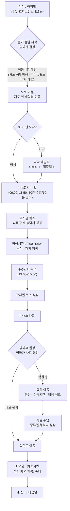

# 이로이의 하루 — 설계 문서 v0.1

프린세스 메이커 2 스타일의 생활 육성 시뮬레이션. 서울 성동구에 사는 초등학교 2학년 "이로이"의 등교·수업·학원·귀가 하루를 실제 동선을 고려해 보낸다.

- 장르: 생활 시뮬레이션 / 자녀 육성
- 플랫폼: 웹 브라우저
- 지도 엔진: **제공사 미정** — 과금이 걸린 결정이라 보류. 인터페이스(`MapService`)만 먼저 고정하고, 지금은 더미 이동시간(`etaMinFromHome`)으로 대체한다.

## 01. 캐릭터 & 무대

| 구분 | 이름 | 주소 | 비고 |
|---|---|---|---|
| 주인공 | 이로이 (초2, 8세) | — | 플레이어는 "엄마" 시점으로 하루 일정을 편성 |
| 집 | 금호파크힐스 113동 | 서울 성동구 금호로 140 일대 (금호동1가) | 동 출입구 좌표를 지오코딩 기준점으로 사용 |
| 학교 | 서울금북초등학교 | 서울 성동구 행당로1길 13 | 집에서 도보 약 10분 내외 거리 |
| 학원 권역 A | 동네 학원가 | 금호·행당 일대 (가상 배치, 집 도보 10분) | §05 참고 |
| 학원 권역 B | 압구정 프리미엄 교육 | 강남구 압구정동 (미정) | 이동시간·비용 ↑, 성장 효율 ↑ |

> 실제 위도·경도는 지도 API 선정 후 Geocoding으로 확정한다. 이 문서의 좌표는 모두 placeholder.

## 02. 하루 루프



### 시간표 기준

| 구간 | 시각 | 내용 |
|---|---|---|
| 등교 가능 구간 | 07:30–08:59 | 엄마가 출발 시각 지정 (이동시간 감안해 9시 전 도착) |
| 1~3교시 | 09:00–11:50 | 매 정시부터 50분 수업 + 10분 휴식 |
| 점심시간 | 12:00–13:00 | 급식 — 허기 회복의 기본 축 |
| 4~6교시 | 13:00–15:50 | 동일 패턴 |
| 하교 | 16:00 | 학원 이동 또는 귀가 분기 |

## 03. 능력치 시스템

6개 기본 능력치. 수업 퀴즈와 방과후 학원 활동이 서로 다른 능력치를 성장시키며, 허기·체력 상태에 따라 성장 효율이 달라진다.

| 능력치 | 설명 | 주요 성장 경로 |
|---|---|---|
| 지력 | 국어·수학·탐구 이해력 | 교과 퀴즈, 교과/논술/코딩 학원 |
| 체력 | 기초 건강, 피로 회복력 | 급식·저녁밥, 체육 퀴즈, 운동학원 |
| 근력 | 신체 능력, 운동 수행력 | 축구·농구·야구·태권도 학원 |
| 감성 | 음악·미술·표현력 | 음악/미술 퀴즈, 미술·코딩 학원, 압구정 예술 아카데미 |
| 사회성 | 발표·교우관계·협동 | 국어 퀴즈(발표), 창의적 체험활동, 팀스포츠·논술 학원 |
| 성실성 | 생활습관, 등교/과제 태도 | 정시 등교, 숙제 완료, 태권도 등 규율형 학원 |

교과 → 능력치 매핑은 데이터로 관리한다 → [`data/subjects.json`](../data/subjects.json)

```
성장치 = 기본계수(과목·난이도) × 퀴즈정답여부(0 or 1) × 허기보정 × 체력보정
```

## 04. 허기 · 체력

- **허기도(0–100)**: 시간이 지날수록 자연 감소(교시당 −6 내외). 급식·저녁밥·간식으로 즉시 회복. 30 이하 "배고픔".
- **체력(0–100)**: 수면·식사로 회복, 수업·학원·이동으로 소모.

| 상태 | 조건 | 효과 |
|---|---|---|
| 배고픔 | 허기 ≤ 30 | 퀴즈 정답률 −20%p, 능력치 성장 배율 ×0.5 |
| 공복 위험 | 허기 ≤ 10 | 체력 자연 감소 시작 |
| 충분 | 허기 ≥ 60 | 능력치 성장 배율 ×1.0 (기본값) |
| 저체력 | 체력 ≤ 20 | 운동학원 참여 불가, 이동속도 저하 |

```
허기보정계수 = 허기 < 30 → 0.5  /  30–59 → 0.8  /  60↑ → 1.0
```

## 05. 학원 & 동선

방과후 학원은 매번 엄마(플레이어)가 선택한다. 성장 능력치뿐 아니라 **동선(학교→학원→집)**, **이동시간**, **비용**, **체력 소모**를 함께 고려한다.

학원 종류(규칙)와 실제 학원(콘텐츠)을 분리해 관리한다 → [`data/academy_categories.json`](../data/academy_categories.json), [`data/academies.json`](../data/academies.json)

| 카테고리 | 실제 후보 | 권역 | 주요 성장 | 동선 |
|---|---|---|---|---|
| 무도 | 태비KTS태권스쿨 | 동네 (가상, 집 도보 10분) | 근력·성실성 | 도보 10분 |
| 미술 | 하이파이브미술학원 성동캠퍼스 | 동네 (가상, 집 도보 10분) | 감성 | 도보 10분 |
| 논술·독서토론 | 씨엔에이논술 행당점 | 동네 (가상, 집 도보 10분) | 지력·사회성 | 도보 10분 |
| 코딩·STEAM | 창의코딩랩 AI코딩학원 | 동네 (가상, 집 도보 10분) | 지력·감성 | 도보 10분 |
| 구기 운동 | 축구·농구·야구 (미정) | 동네 | 근력·사회성 | 도보 5–15분, 체력 소모 큼 |
| 프리미엄 교육 | 압구정 영어회화·창의수학·예술 (미정) | 강남(압구정) | 지력·감성 (고배율) | 차량/대중교통 20–40분, 고비용 |

### 학원 선택 판정 로직

1. **도착 가능성** — 학교→학원 이동시간 + 학원 운영시간이 16:00 이후 일정과 맞는지
2. **귀가 가능성** — 학원→집 이동시간을 더해 저녁밥 시간을 넘기지 않는지
3. **예산 검증** — 이번 달 남은 교육예산에서 수강료 차감 가능한지
4. **체력 검증** — 현재 체력이 해당 학원의 최소 요구 체력 이상인지

## 06. 예산 시스템

매월 21일 엄마·아빠의 월급이 들어오고 그 달 교육 예산이 재계산된다.

```
이번달_교육예산 = (엄마월급 + 아빠월급) × 교육비_비율 − 고정지출(생활비·관리비 등) + 전월_이월분
```

| 항목 | 시점/주기 | 비고 |
|---|---|---|
| 월급 입금 | 매월 21일 | 예산 재계산 트리거 |
| 동네 학원 수강료 | 월 단위 선결제 | 등록 시 즉시 차감 |
| 압구정 프리미엄 수강료 | 월 단위 선결제, 고액 | 왕복 교통비 별도 차감 |
| 식비·간식 | 매 식사 이벤트 | 급식은 무상, 간식/외식만 차감 |
| 예산 초과 | 즉시 | 등록 불가 — 대체 학원 추천 |

## 07. 지도 이동 모듈

지도 API 선택은 보류. 게임 로직이 어떤 지도 제공사든 뒤에서 바꿔 끼울 수 있도록 `MapService` 인터페이스만 먼저 고정한다.

```ts
interface MapService {
  geocode(address: string): Promise<LatLng>

  getRoute(
    from: LatLng,
    to: LatLng,
    mode: "walk" | "transit" | "car"
  ): Promise<{ path: LatLng[], durationSec: number, distanceM: number }>

  spawnCharacter(at: LatLng): CharacterMarker

  moveCharacterAlong(
    marker: CharacterMarker,
    path: LatLng[],
    gameMinutesPerRealSecond: number
  ): Promise<void>

  onArrive(marker: CharacterMarker, cb: () => void): void
}
```

프로토타입 단계에서는 더미 좌표 + `etaMinFromHome` 값으로 이동 로직을 먼저 검증하고, 실제 API는 비용·약관 검토 후 나중에 연결한다.

```
지각 여부 = (출발시각 + 이동시간) > 09:00
지각 시 → 성실성 ↓, 1교시 집중력 보정 ↓
```

## 08. 데이터 모델

**원칙**: "학원이 무엇을 성장시키는가"(규칙, 거의 안 바뀜)와 "그 학원이 실제로 어디 있고 얼마인가"(콘텐츠, 언제든 추가)를 분리한다. 새 학원·새 과목 추가는 테이블에 행을 추가하는 것으로 끝나고, 게임 로직 코드는 건드리지 않는다. 실제 파일은 [`data/`](../data) 참고.

- `Character` — 캐릭터 상태 (`data/character.json`)
- `AcademyCategory` — 학원 종류별 성장 규칙 (`data/academy_categories.json`)
- `Academy` — 실제 학원 인스턴스 (`data/academies.json`)
- `Subject` — 교과목별 성장 규칙 (`data/subjects.json`)
- `DailySchedule` — 하루 일정 (구현 시 추가)
- `FamilyBudget` — 가계 예산 (구현 시 추가)

## 09. 화면 구성 초안

- **메인 화면**: 지도(또는 더미 맵)가 화면 대부분을 채우고 캐릭터 마커가 이동. 상단 날짜·게임시계, 좌측 능력치 게이지 + 허기/체력 바.
- **주간 플래너**: 요일별 방과후 학원을 미리 배정. 학원 카드에 이동시간·비용·예상 성장치 표시.
- **퀴즈 팝업**: 교시 시작 시 과목에 맞는 간단 퀴즈 1문항.
- **가계부 화면**: 21일 월급 입금, 이번 달 교육예산 잔액, 학원별 지출 내역.

## 10. 다음 단계

- [ ] 하루 루프 1일치를 더미 데이터로 프로토타이핑 (등교 지각 판정, 퀴즈, 방과후 학원 1곳)
- [ ] 능력치/허기/예산 수치 밸런싱
- [ ] 태비KTS태권스쿨 · 씨엔에이논술 행당점 · 하이파이브미술학원 성동캠퍼스 · 창의코딩랩의 실제 운영시간·수강료 확인
- [ ] 지도 제공사 결정 (네이버 vs 구글 vs 그 외) — 요금제·무료 할당량 비교
- [ ] 집·학교·학원 실주소를 선택한 Geocoding API로 좌표 확정
- [ ] `MapService` 인터페이스를 선택한 SDK로 구현
